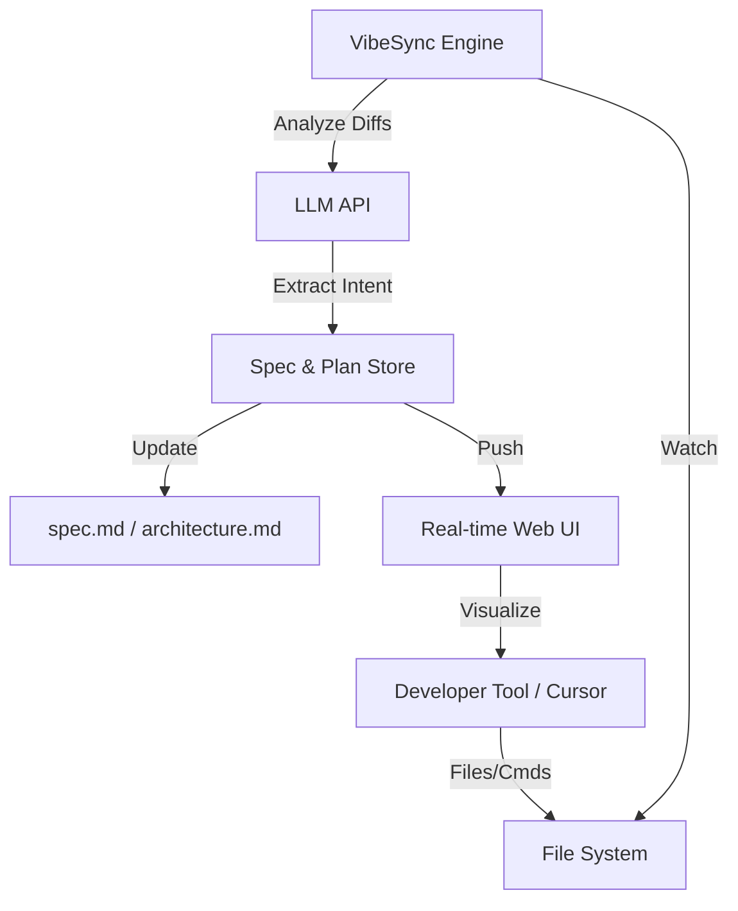

# Engineering Requirements Documentation (ERD): VibeSync

## 1. Goal
VibeSync aims to bridge the gap between unstructured "Vibe Coding" and professional engineering standards by automatically capturing intent, architecture, and specifications from development sessions without human overhead.

---

## 2. Target Audience
- Hackathon participants and rapid prototypers.
- Individual developers using AI coding assistants (Cursor, Claude Code, Windsurf).
- Small teams looking for low-friction documentation.

---

## 3. Functional Requirements

### 3.1 Vibe Capture (Core)
- **File System Watcher**: Monitor the project directory for changes in real-time.
- **Diff Analysis**: Analyze git diffs (or file state differences) to understand *what* changed.
- **Intent Extraction**: Use an LLM to infer the *why* and the *how* from code changes and terminal output.

### 3.2 Automated Documentation
- **Auto-Architecture**: Maintain a `docs/architecture.md` that updates as the codebase structure evolves.
- **Auto-Spec**: Update a `docs/spec.md` when new features or logic are implemented.
- **Task Tracking**: Synchronize with a `task.md` to mark items as [x] automatically upon implementation.

### 3.3 Vibe Sentinel (Alerts)
- **Drift Detection**: Alert the user when new code shifts significantly from the defined `spec.md`.
- **"Why" Prompting**: Optionally interrupt a "vibe" session with a quick prompt (via CLI or UI) to capture an architectural decision if the AI makes a major change.

---

## 4. Technical Stack

| Layer | Technology | Rationale |
| :--- | :--- | :--- |
| **CLI / Engine** | Node.js (TypeScript) | High ecosystem support for file-watching and CLI tools. |
| **LLM Engine** | OpenAI (GPT-4o) / Anthropic (Claude 3.5 Sonnet) | Needs high reasoning capabilities for intent extraction. |
| **UI Dashboard** | Next.js + Vanilla CSS | Modern, fast, and rich aesthetics for the real-time "Mental Model" view. |
| **Local DB** | SQLite / LevelDB | Lightweight local storage for session history and project context. |
| **Watcher** | Chokidar | Robust cross-platform file system watching. |

---

## 5. System Architecture

---

## 6. Non-Functional Requirements
- **Low Latency**: Intent extraction should happen in the background within 5-10 seconds of a file save.
- **Non-Intrusive**: Must not slow down the IDE or the developer's "vibe".
- **Security**: All API keys and session data must be stored locally.

---

## 7. MVP Roadmap
1.  **Phase 1**: CLI tool that watches a folder and logs file-change summaries to a hidden `.vibesync/` folder.
2.  **Phase 2**: LLM integration to update a `spec.md` from those summaries.
3.  **Phase 3**: Simple local dashboard visualizing the current project "Mental Model".
